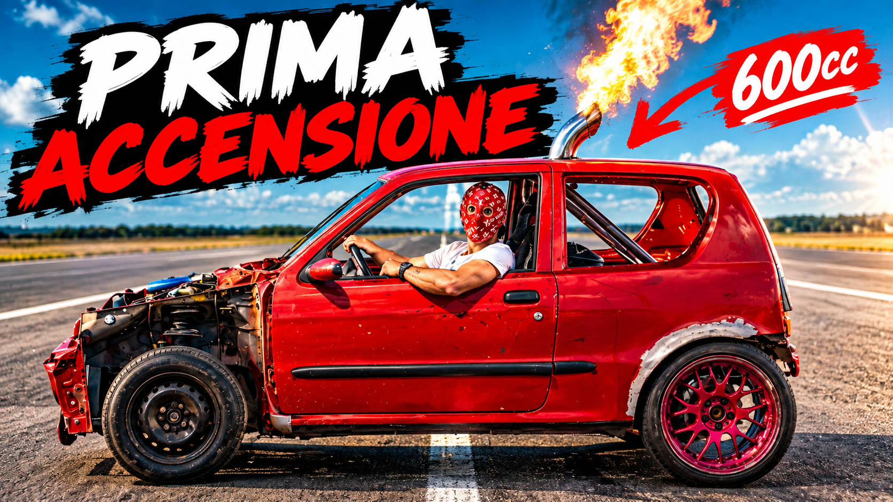

# Graphic Design & Visual Communication Portfolio

  <b>A Curated Selection of 23 Visual Design Projects Showcasing Expertise in Brand Identity, Digital Graphics, Print Design, and Visual Communication</b>

  
  
  
  
  

  <a href="#-overview">Overview</a> •
  <a href="#-areas-of-expertise">Expertise</a> •
  <a href="#-tools--technologies">Tools</a> •
  <a href="#-work-showcase">Showcase</a> •
  <a href="#-contact">Contact</a>

---

## Overview

Welcome to my graphic design showcase. This repository features a curated selection of 23 visual design projects, demonstrating a strong foundation in visual composition, typography, and brand identity. From digital graphics to print design, each project reflects a commitment to high-quality visual communication and creative problem-solving.

---

## Preview

  

---

## Areas of Expertise

- **Brand Identity:** Logo design, brand guidelines, and visual identity systems.
- **Digital Graphics:** Social media assets, web graphics, and digital campaigns.
- **Print Design:** Editorial layouts, posters, and marketing collateral.
- **Visual Communication:** Typography, color theory, and vector illustration.

---

## Tools & Technologies

### Design Software
- **Adobe Creative Cloud:** Photoshop, Illustrator, InDesign.
- **UI/UX & Prototyping:** Figma, Canva.

### Core Design Principles
- Visual Composition
- Typography
- Vector Illustration
- Brand Identity Systems

---

## Work Showcase

Below is a curated collection of selected graphic design works:

### 01 – 05

  
  

  
  

  

---

### 06 – 10

  
  

  
  

  

---

### 11 – 15

  
  

  
  

  

---

### 16 – 20

  
  

  
  

  

---

### 21 – 22

  
  

---

## Contact & Support

- **Maintainer:** [@nowii-core](https://github.com/nowii-core)
- **Status:** Open for freelance projects, visual design collaborations, and full-time opportunities.
- **GitHub Profile:** [github.com/nowii-core](https://github.com/nowii-core)

---

  Developed by <b>nowii-core</b>

